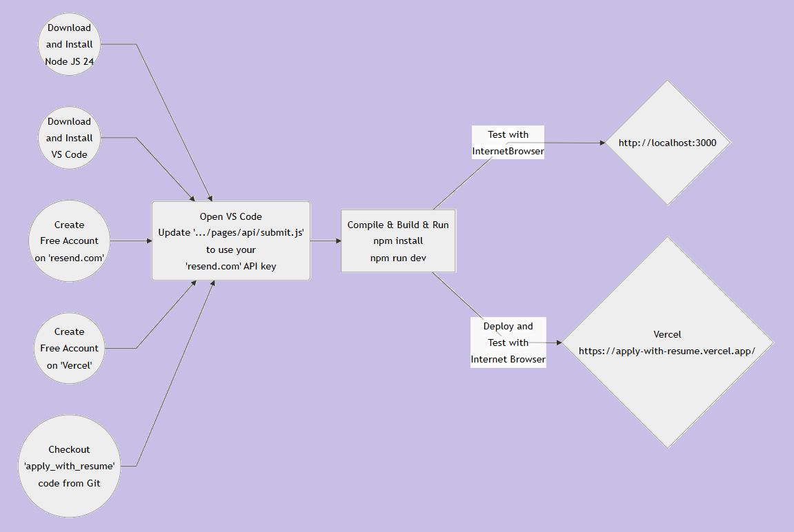
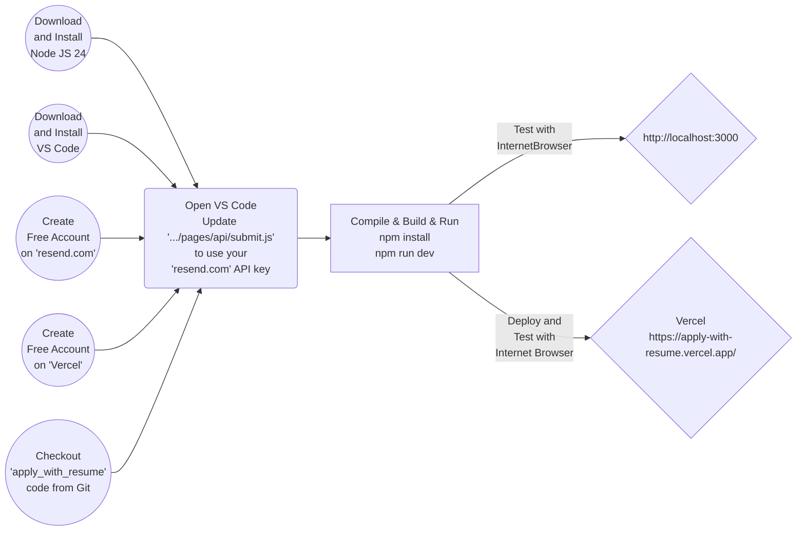

# Step by Step Tutorial to Create a Simple Web Application to Upload IT Job Skills using Next JS

### Workflow

### Getting Started

<ul>
<li>Checkout <a  href="https://github.com/lalumastan/apply_with_resume.git">this code</a> from Github</li>
<li>Install <a href="https://nodejs.org" target="_new">Node.js 24.x</a> or later &mdash; required by Vercel for new builds</li>
<li>Create a free account on <a  href="https://resend.com" target="_new">resend.com</a> (no credit card required) and generate an API key</li>
<li>Copy <code>.env.example</code> to <code>.env.local</code> and set <code>RESEND_API_KEY</code> and <code>TO_EMAIL</code> (the inbox that should receive applications)</li>
<li>Compile and build the code using <code>npm install</code></li>
<li>Run the development server using <code>npm run dev</code></li>
<li>Open <a  href="http://localhost:3000" target="_new">http://localhost:3000</a> with your browser to see the result.</li>
<li>You can start editing the page by modifying <code>.../src/pages/index.js</code>. The page auto-updates as you edit the file.</li>
</ul>
This project uses <a href="https://nextjs.org/docs/basic-features/font-optimization" target="_new">next/font</a> to automatically optimize and load IBM Plex Mono and IBM Plex Sans, custom Google Fonts.

Submitted applications, including the résumé attachment, are emailed directly to <code>TO_EMAIL</code> via the <a href="https://resend.com" target="_new">Resend</a> API from <code>.../src/pages/api/submit.js</code> &mdash; no third-party form dashboard required.

### Deploy on Vercel
The easiest way to deploy your Next.js app is to use the [Vercel Platform](https://vercel.com/new?utm_medium=default-template&filter=next.js&utm_source=create-next-app&utm_campaign=create-next-app-readme) from the creators of Next.js.

When deploying, add <code>RESEND_API_KEY</code> and <code>TO_EMAIL</code> under Project Settings &rarr; Environment Variables.

Check out the [Next.js deployment documentation](https://nextjs.org/docs/deployment) for more details.

### References
<ul>
<li><a  href="https://icsdiscover.great-site.net/?site=awr" target="_new">Live Demo</a></li>
<li><a  href="https://nextjs.org/learn" target="_new">Interactive Next.js tutorial</a></li>
<li><a  href="https://nextjs.org/docs" target="_new">Next.js Documentation</a></li>
<li><a  href="https://reactjs.org/" target="_new">React</a></li>
<li><a  href="https://vercel.com" target="_new">Vercel</a></li>
<li><a  href="https://resend.com" target="_new">Resend &mdash; free transactional email API for developers</a></li>
</ul>

### Tutorial

